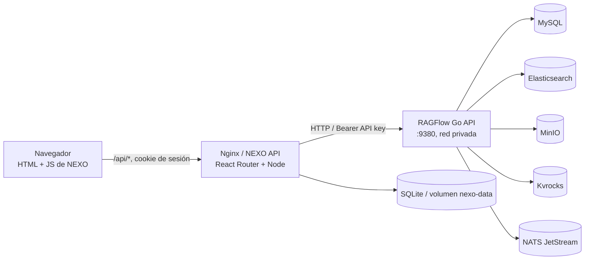

# Análisis de uso e integración de RAGFlow en NEXO

Fecha de inspección: 2026-10-15
Propósito: dejar contexto verificable para agentes y proyectos que vayan a integrar RAGFlow.

## Resumen

RAGFlow es el motor de conocimiento de NEXO: administra datasets, documentos, extracción y procesamiento, índices/chunks, grafos disponibles y asistentes de consulta. NEXO mantiene la experiencia del producto, usuarios, workspaces, permisos, actividad y una API intermediaria. El navegador no necesita conocer ni guardar la API key de RAGFlow: llama a la API de NEXO, y el servidor Node llama a RAGFlow.

La integración que existe en este prototipo ya no depende de un checkout externo en `../ragflow-be`: `nexo-prototipe/vendor/ragflow` contiene una exportación seleccionada de RAGFlow Go `v1.0.0-rc1`, fijada al commit `14bb02ee4584c1ab18f0c722c48beecd6bbf9860`. Docker construye desde esa copia, y Compose levanta también sus servicios de datos. No se incluye la consola web de administración de RAGFlow; NEXO aporta sus propios paneles para los flujos que usa.

## Alcance y cómo leer el código

- `../../ragflow-be` es el checkout completo inspeccionado para entender el sistema original. Su guía local está en [`AGENTS.md`](../../ragflow-be/AGENTS.md).
- `../vendor/ragflow/UPSTREAM.md` describe qué versión/código de RAGFlow se exportó, qué se dejó afuera y los cambios locales conocidos.
- `../README.md`, `../docker-compose.yml` y `../docker/ragflow-backend.Dockerfile` describen el despliegue integrado vigente.
- [`ragflow-discoveries.md`](ragflow-discoveries.md) distingue ahora la propuesta inicial del estado integrado vigente; README, Compose y `vendor/ragflow/UPSTREAM.md` describen la versión y el despliegue actuales.
- El checkout de NEXO tenía modificaciones sin commit durante la inspección. Este documento registra el código visible en ese momento; verificar el estado actual antes de convertir una observación en contrato permanente.

## RAGFlow original: responsabilidades y arquitectura

RAGFlow no equivale a un conjunto de endpoints aislados. Es un motor de RAG que recibe fuentes documentales, las procesa y estructura, indexa y recupera fragmentos relevantes, y sirve respuestas mediante chats/asistentes. La configuración del modelo, embeddings, parser y estrategia de recuperación vive principalmente del lado de RAGFlow.

El checkout original tiene dos generaciones de backend en paralelo. El Go es la ruta activa de migración e incluye API, admin, ingestor, syncer, parsing/DeepDoc, ejecución de agentes y recuperación. También siguen presentes el backend Python y su frontend mientras avanza esa migración; la guía de RAGFlow aclara que Go-only es el objetivo y que el arranque upstream puede seguir usando Python si no se selecciona explícitamente Go. No asumir que cualquier instalación o versión ofrece el mismo backend, configuración o endpoints.

En Go, el flujo de alto nivel es:

1. `cmd/ragflow_server.go` selecciona el modo de servicio (`--api`, `--admin`, `--ingestor`, `--syncer`) y arma dependencias/configuración.
2. `internal/router/router.go` registra endpoints públicos y autenticados bajo `/api/v1`.
3. `internal/handler/` traduce HTTP a operaciones de dominio; `internal/service/`, `internal/dao/` y `internal/entity/` implementan negocio y persistencia.
4. `internal/ingestion/`, `internal/parser/` e `internal/deepdoc/` procesan documentos y alimentan el motor de índice/recuperación de `internal/engine/`.
5. `internal/rag/` y los servicios de chat conectan búsqueda, chunks/contexto y modelos para responder.

La aplicación depende de servicios con estado: según el perfil, MySQL/PostgreSQL, Elasticsearch/Infinity/OpenSearch, MinIO, Kvrocks y NATS, entre otros. El despliegue integrado de NEXO escoge un subconjunto concreto y no representa todos los perfiles posibles de RAGFlow.

El frontend original de RAGFlow es otra aplicación (React/TypeScript en `ragflow-be/web`) y su panel cubre muchas más funciones administrativas que NEXO. NEXO no reutiliza esa interfaz ni importa sus handlers para hacerlos correr dentro de Node.

Capacidades relevantes del motor upstream incluyen parsing y chunking por plantillas, extracción de conocimiento, recuperación híbrida/reranking, chats con referencias, agentes y MCP. Su disponibilidad depende de la versión, del modelo configurado y del perfil desplegado. Para NEXO, las capacidades efectivamente aprovechadas se limitan a los contratos HTTP descritos más abajo.

## Frontend de NEXO

La UI que se sirve hoy es principalmente HTML/CSS/JavaScript estático en `public/`, no una SPA React que hable directamente con RAGFlow. La ruta raíz de React Router redirige al shell [`public/nexo-prototipo.html`](../public/nexo-prototipo.html); sus scripts implementan las vistas de chat, workspace, administración, documentos, proveedores, fuentes y grafo. El runtime React Router también hospeda las rutas de API del servidor.

El frontend:

- consume rutas propias de NEXO, como `/api/datasets`, `/api/datasets/:id/chat`, `/api/datasets/:id/graph`, `/api/workspaces/*` y `/api/admin/*`;
- no contiene la URL/token de RAGFlow ni llama a su host directamente;
- presenta datasets y asistentes, consulta chats, permite operaciones de documentos y muestra referencias de respuestas;
- permite administrar conexión/capacidades, datasets, asistentes y fuentes de datos según permisos y compatibilidad detectada;
- presenta permisos y recursos desde el modelo de workspaces de NEXO, no desde una sesión RAGFlow individual por cada usuario final.

El grafo prioriza el grafo/mind map real devuelto por RAGFlow. Cuando no está disponible, el endpoint de NEXO construye una visualización explicable a partir de documentos, chunks, palabras clave y metadatos compartidos. Ese fallback es calculado por NEXO en cada solicitud; no equivale a un grafo de conocimiento persistido por RAGFlow ni debe describirse como tal.

Referencias de código: [`app/routes.ts`](../app/routes.ts), [`app/routes/home.tsx`](../app/routes/home.tsx), [`public/nexo-ragflow.js`](../public/nexo-ragflow.js), [`app/routes/api.graph.ts`](../app/routes/api.graph.ts).

## Backend adaptador de NEXO

El backend Node/React Router funciona como una fachada con autenticación y autorización de NEXO, y como cliente HTTP de RAGFlow. No sustituye al motor Go ni se conecta directamente a sus bases/índices.

### Adaptador HTTP y configuración

[`app/server/ragflow.server.ts`](../app/server/ragflow.server.ts) resuelve URL y credencial efectivas, agrega `Authorization: Bearer …`, normaliza errores/respuestas y distingue JSON de descargas binarias (`ragflowFetch`). La API key se mantiene en el servidor.

La URL/key de despliegue (`RAGFLOW_BASE_URL`, `RAGFLOW_API_KEY`) sirven como fallback. El site admin puede guardar un override; la key se cifra con AES-256-GCM usando `NEXO_ENCRYPTION_KEY`. Cambiar esta clave deja inaccesibles los overrides cifrados existentes. El navegador solo recibe si la key está configurada, nunca el valor. Ver [`app/server/ragflow-settings.server.ts`](../app/server/ragflow-settings.server.ts), [`app/server/secrets.server.ts`](../app/server/secrets.server.ts) y `.env.example`.

La acción de diagnóstico comprueba endpoints para datasets, chats, connectors y tokens, y devuelve capacidades según respuestas HTTP. Esto es importante porque connectors, MCP y otros contratos cambian entre versiones/distribuciones: la existencia en la UI no garantiza que una instancia los soporte.

### Contratos HTTP observados

| Uso en NEXO | Endpoint de RAGFlow | Resultado/decisión |
|---|---|---|
| Listar/crear/editar/borrar datasets | `/api/v1/datasets` y `/api/v1/datasets/{id}` | RAGFlow es dueño del dataset y su configuración de parser. |
| Listar y vincular chats | `/api/v1/chats`, `/api/v1/chats/{id}` | NEXO representa los chats como asistentes; el vínculo dataset-chat debe resolverse/configurarse. |
| Cargar documentos | `/api/v1/datasets/{id}/documents` (multipart) | El archivo pasa por el backend NEXO; nunca se manda la API key al browser. |
| Procesar/reintentar/detener | `/api/v1/datasets/{id}/chunks`, `/api/v1/documents/ingest` | El backend elige ruta según si el dataset usa parser clásico o pipeline. El trabajo real es asíncrono de RAGFlow. |
| Leer documentos y fragmentos | `/api/v1/datasets/{id}/documents`, `.../documents/{document_id}/chunks` | Se usa para vistas, progreso y grafo derivado. |
| Grafo de conocimiento | `/api/v1/datasets/{id}/graph` | Si no hay artefacto usable, NEXO deriva vínculos documentales desde datos de chunks/metadata. |
| Chat con referencias | `/api/v1/openai/{chat_id}/chat/completions` | Se envía `extra_body.reference=true`; la respuesta normaliza texto, referencias y conversation ID. |
| Data Sources/connectors | `/api/v1/connectors...` | Se ofrecen si la instancia confirma que expone esos endpoints. |
| Sesiones | `/api/v1/chats/{chat_id}/sessions...` | Compatibilidad con recuperación/listado de sesiones según el chat asociado. |

Rutas de implementación: [`api.admin.datasets.ts`](../app/routes/api.admin.datasets.ts), [`api.admin.datasets.$datasetId.documents.ts`](../app/routes/api.admin.datasets.$datasetId.documents.ts), [`api.admin.assistants.ts`](../app/routes/api.admin.assistants.ts), [`api.chat.ts`](../app/routes/api.chat.ts), [`api.admin.ragflow.ts`](../app/routes/api.admin.ragflow.ts), [`api.admin.data-sources.ts`](../app/routes/api.admin.data-sources.ts).

### Identidad, permisos y datos

- NEXO autentica usuarios con su propia sesión/cookie y SQLite. Sus roles y membresías de workspace autorizan cada operación antes de llamar a RAGFlow.
- El cliente técnico usa una API key de RAGFlow compartida por el servidor NEXO. Por eso, el aislamiento por usuario/workspace debe validarse en NEXO; no asumir que RAGFlow recibe la identidad final de la persona.
- RAGFlow conserva datasets, documentos, estado de ingestión, chunks/índice, chats y configuración de modelos. NEXO conserva usuarios, workspaces/membresías, ownership/compartición de asistentes, actividad, aprobación/registro MCP y settings de conexión.
- La cuenta bootstrap de RAGFlow y el usuario técnico son distintos: la cuenta de servicio debe ser regular, no superuser, ya que RAGFlow rechaza operaciones de datasets para superusuarios. Esta decisión está documentada en `UPSTREAM.md` e implementada en el bootstrap de `vendor/ragflow/internal/admin/service.go`.

## Qué se modificó o seleccionó de RAGFlow para el prototipo

No se copió el repositorio upstream entero. El manifiesto [`vendor/ragflow/UPSTREAM.md`](../vendor/ragflow/UPSTREAM.md) registra una exportación de aproximadamente 34 MB con la clausura Go necesaria para compilar/ejecutar el backend y sus assets nativos.

Selección principal:

- Incluye `cmd/`, `internal/`, `common/`, `conf/` y los assets/configuración necesarios de plantillas, prompts, migraciones y dependencias Go.
- Excluye el runtime Python, UI web admin de RAGFlow, SDKs, ejemplos, Compose upstream y perfiles opcionales de motores. NEXO ofrece su propia interfaz de operaciones.
- Mantiene `internal/` completo porque handlers y servicios dependen de muchos paquetes internos; extraer unos pocos endpoints no daría un servidor compilable ni inicializable.
- Mantiene licencia Apache-2.0 y un pin explícito de upstream para que una actualización sea revisable.

Parches/perfil local declarados en `UPSTREAM.md`:

- arranca la API Go directamente en el puerto 9380, sin Nginx ni frontend admin de RAGFlow;
- reduce a uno el worker de ingesta por defecto para el perfil de recursos limitado;
- sustituye credenciales admin predeterminadas por bootstrap configurable de NEXO y crea el usuario/tenant regular de servicio para la API key;
- agrega `--nexo-profile` a la preparación de dependencias para omitir sidecars opcionales de Stagehand Browser;
- renueva en la imagen builder la librería `office_oxide` y empaqueta librerías nativas, modelos/tokenizers requeridos por Go.

Estos cambios hacen el perfil integrable y autónomo; significan que actualizar upstream no es simplemente cambiar un tag. Hay que revisar el manifiesto, reaplicar/verificar los parches, regenerar la exportación y comprobar las APIs usadas.

## Despliegue elegido

[`docker-compose.yml`](../docker-compose.yml) arranca `nexo` (web estática/Nginx), `nexo-api`, `ragflow-backend`, MySQL, Elasticsearch, MinIO, Kvrocks y NATS. El servicio RAGFlow expone 9380 dentro de la red privada y solo lo publica en loopback para desarrollo local; 9381 y puertos de datos no se publican. Los volúmenes preservan bases, índices, objetos, estado de Kvrocks/NATS y datos NEXO.

El Dockerfile [`docker/ragflow-backend.Dockerfile`](../docker/ragflow-backend.Dockerfile) compila la exportación Go y prepara sus dependencias nativas. La imagen integra NEXO web/API/backend sin exigir `../ragflow-be` en tiempo de build ni una instalación separada de RAGFlow.

## Capacidades y límites que debe conocer otro agente

| Capacidad | Estado en la integración observada |
|---|---|
| Consultar datasets/chats y validar dataset | Integrada mediante API HTTP de RAGFlow. |
| Crear/configurar datasets | Integrado en panel NEXO; la validación de campos no significa que todas las opciones de parser sean independientes de versión. |
| Cargar/procesar/reintentar/detener documentos | Integrado; el procesamiento ocurre en workers de RAGFlow y requiere revisar estado/progreso después. |
| Preguntar al asistente | Integrado con chat vinculado; intenta enviar referencias explícitas para que NEXO pueda mostrar evidencia. |
| Grafo | Usa artefacto upstream cuando existe; fallback de NEXO desde chunks, keywords, nombres y metadata cuando no existe. |
| Data Sources | Panel/API condicionados a que `/api/v1/connectors` y las operaciones específicas estén presentes. |
| MCP | NEXO registra servidores Streamable HTTP, descubre herramientas y guarda aprobaciones. La invocación desde el chat está intencionalmente deshabilitada hasta validar contrato compatible end-to-end con RAGFlow. |
| Consola admin completa RAGFlow | Excluida del bundle; NEXO cubre el subconjunto operacional usado. |
| Modelos/proveedores avanzados | Siguen siendo conceptos/configuración de RAGFlow; no asumir que NEXO reemplaza todo ese panel. |

La detección de disponibilidad es por endpoint, no una garantía universal de compatibilidad semántica. Un 200 en una ruta base no demuestra que cada operación, campo o versión de respuesta coincida con lo que espera NEXO.

## Decisiones transferibles a futuros proyectos

1. **Integrar por API HTTP y mantener un adaptador del lado servidor.** Así se evita acoplar otro producto a paquetes internos, sesiones/cookies de RAGFlow o su estructura de base de datos.
2. **Separar propiedad de datos.** Definir qué sistema manda sobre documentos/índice/asistentes y qué sistema manda sobre usuarios/workspaces/permisos antes de construir pantallas.
3. **Resolver identidad de servicio deliberadamente.** Probar restricciones del rol RAGFlow con el usuario API real; no usar un admin global como atajo. En integración multiusuario, auditar qué controles se aplican antes de cada llamada con credencial compartida.
4. **No filtrar secretos al cliente.** Mantener key en servidor, cifrar overrides persistentes, evitar loguear headers y usar URL interna del servicio cuando corre bajo Compose.
5. **Tratar contratos como versionados/variables.** Fijar versión y probar capacidades concretas; diagnosticar cada endpoint y mostrar límites reales. No convertir endpoints experimentales en requisitos silenciosos.
6. **Respetar el flujo de ingesta asíncrono.** Subir un archivo no implica que esté indexado; distinguir estados, parser clásico/pipeline, fallas y reintentos.
7. **Preservar evidencia de respuesta.** Solicitar referencias, normalizar variantes de envelope y mostrar fuentes, en lugar de presentar solo texto generado.
8. **Nombrar correctamente los fallbacks.** Un grafo calculado a partir de coocurrencias no tiene la misma semántica que un grafo de conocimiento extraído por el motor.
9. **Planear costo operativo.** RAGFlow trae motores con estado y consumo de memoria/disco relevante. El número de workers, almacenamiento e índice son decisiones del perfil, no detalles gratuitos del cliente web.
10. **Si se vende una copia embebida, fijar procedencia y patches.** Registrar commit/licencia, lista de archivos, cambios locales y procedimiento de actualización. Evitar copiar solo handlers de una aplicación que depende de una clausura interna grande.

## Aclaraciones de alcance y puntos a verificar

- `docs/ragflow-discoveries.md` ahora identifica como históricos el diagnóstico y la propuesta de mantener RAGFlow externo, y describe por separado el perfil Go integrado vigente.
- Algunas rutas de Data Sources y MCP son dependientes de build/versión; NEXO lo refleja con diagnóstico y con invocación MCP apagada. Revisar contrato de la instancia destino, no extrapolarlo desde el prototipo bundled.
- Para instalaciones externas a Compose, cambiar la URL base y credencial no garantiza que el backend esté en modo Go, que use el mismo commit, que la API key tenga permisos, o que conectores y campos existan.
- El límite de memoria por servicio del Compose no predice el consumo total; influye el tamaño de índice/documentos, concurrencia, parsing y configuración de modelos.
- Antes de cambiar la integración, comprobar worktree/commit y revisar las modificaciones locales existentes en `nexo-prototipe`; no asumir que los archivos visibles están todos commiteados.

## Mapa de archivos recomendado

| Pregunta | Archivos para empezar |
|---|---|
| ¿Qué versión de RAGFlow está incluida y qué se parchó? | `vendor/ragflow/UPSTREAM.md`, `vendor/ragflow/VERSION` |
| ¿Cómo se construye y arranca el backend? | `docker/ragflow-backend.Dockerfile`, `vendor/ragflow/docker/entrypoint-go.sh`, `docker-compose.yml` |
| ¿Cómo llega una petición desde NEXO a RAGFlow? | `app/server/ragflow.server.ts`, luego la ruta `app/routes/api.*` correspondiente |
| ¿Cómo se guarda/protege la API key? | `app/server/ragflow-settings.server.ts`, `app/server/secrets.server.ts`, `app/routes/api.admin.settings.ragflow.ts` |
| ¿Cómo se aplica autorización por usuario/workspace? | `app/server/auth.server.ts`, `app/server/workspaces.server.ts`, handler de la ruta relevante |
| ¿Cómo se arma una consulta con evidencia? | `app/routes/api.chat.ts`, `app/server/assistants.server.ts` |
| ¿Cómo funciona el grafo? | `app/routes/api.graph.ts`, `public/nexo-ragflow.js` |
| ¿Dónde vive el contrato original de RAGFlow? | `../../ragflow-be/cmd/ragflow_server.go`, `../../ragflow-be/internal/router/router.go`, `../../ragflow-be/internal/handler/`, `../../ragflow-be/internal/service/`, `../../ragflow-be/internal/ingestion/` |
